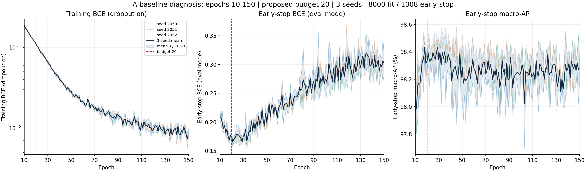
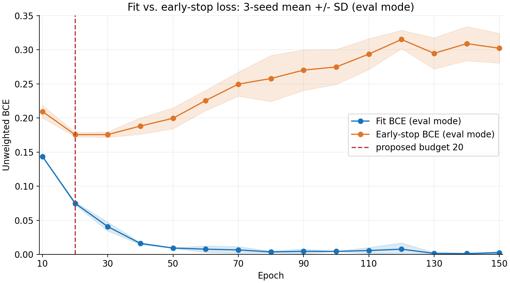

# 10–150 轮训练诊断：建议基线训练预算 20 轮

**结论：当前固定学习率 1e-4 下，建议 A 基线的最大训练轮数采用 20，训练过程中仍按 early-stop macro-AP 保存最佳 checkpoint。** 该预算由三个种子的完整 150 轮曲线和事先固定的容差规则选出。

本轮为训练预算诊断，三种子为 2050、2051、2052。每次 fit 8000、early-stop 1008，150 epoch × 250 updates = 37500 updates；三次合计 112500 updates。模型仍为 dfms_iq / width16 / dropout0.2，F2 共享权重初始化后全模型微调；AdamW lr=1e-4、weight_decay=1e-4、batch32、clip5、FP32、无学习率调度。

## 关键轮次实测值

下表为三种子均值；AP 列用百分数，完整逐种子值与标准差见 CSV。训练 BCE 为 Dropout 开启时的 minibatch loss，early-stop BCE 为 eval 模式；二者的同模式比较见第二张图。

| 轮次 | 训练 BCE | early-stop BCE | 当轮 early-stop macro-AP (%) | 截至当轮最佳 AP 均值 (%) |
|---|---:|---:|---:|---:|
| 8 | 0.21190 | 0.23757 | 97.6498 | 97.6579 |
| 10 | 0.18700 | 0.20958 | 98.0682 | 98.0682 |
| 20 | 0.10962 | 0.17558 | 98.3332 | 98.4538 |
| 30 | 0.06562 | 0.17569 | 98.3421 | 98.4655 |
| 50 | 0.02875 | 0.19960 | 98.2870 | 98.4788 |
| 100 | 0.01212 | 0.27487 | 98.2535 | 98.4788 |
| 150 | 0.00869 | 0.30235 | 98.2784 | 98.4863 |

## 如何确定轮数

在开训前固定候选预算为 10、20、……、150。对每个种子取该预算以内的最佳 early-stop macro-AP；选择相对完整 150 轮最佳值，平均差不超过 0.001 AP（0.1 个百分点）、且任一种子差不超过 0.002 AP 的最早候选预算。这是工程容差，不是统计等效检验。

选择 20 轮时，相对 150 轮的三种子平均最佳 AP 缺口为 **0.0325 个百分点**，最大单种子缺口为 **0.0555 个百分点**。三种子平均 early-stop BCE 最低点在 **第 21 轮**。

| 种子 | 建议预算内最佳 AP 轮次 | 150 轮内最佳 AP 轮次 | early-stop BCE 最低轮次 |
|---|---:|---:|---:|
| 2050 | 19 | 27 | 23 |
| 2051 | 18 | 35 | 33 |
| 2052 | 17 | 138 | 21 |

训练 loss 继续下降而 early-stop loss 上升，说明继续拟合训练样本并不能保证泛化改善。训练预算与最后采用的 checkpoint 轮次是两件事，应保留验证最优的 checkpoint，而非直接使用最后一轮。

## 证据边界与下一步

- 本轮只训练 A 基线，结论适用于当前数据、模型和固定学习率；尚未证明 B/C 的收敛轮次相同。
- calibration / development / locked-test 的波形均未作为模型输入或用于本次选轮；仅核对源容器文件的整体 SHA-256。
- 原 8 轮 A/B/C 的结果保持独立。要更新方法比较，下一轮需冻结共同的新训练预算并重跑 A/B/C，不能将本轮 A 与旧 8 轮 B/C 混比。
- 新训练复用了原初始化和前三种子的前 8 轮身份排列，收据已验证；GPU 缓存输入及 CUDA 数值路径不承诺与旧运行逐位相同。

外部完整产物：`E:\LJQ_code\LJQ_code_experiment_storage\lt_abc_v1\20261106_epoch_diag_01`。三次训练耗时合计 2086.5 秒（不含数据读取、作图与汇总）。

原始逐轮曲线：[curves.csv](curves.csv)；10–150 轮逐 10 轮记录：[checkpoints_10_150.csv](checkpoints_10_150.csv)；预算选择：[horizon_selection.csv](horizon_selection.csv)；完整选择收据：[selection.json](selection.json)。
