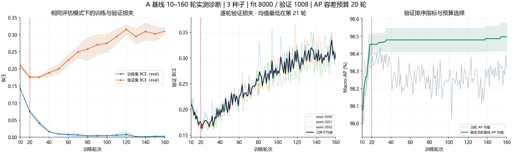

# A 基线延伸至 160 轮

执行于 2026-11-06，轻量归档补齐于 2026-11-07。

从 150 轮诊断的三个状态继续至 160 轮，使用相同 A fit 与 early-stop、种子 2050—2052、固定学习率 1e-4。每轮 250 次更新。数据角色和环境见 [协议](results/protocol.json)。

20 轮仍是首个满足原 AP 容差的候选预算，其 best-so-far AP 均值为 0.98453765，与 160 轮最优均值差约 0.04299 pp。对应逐种子最大差约 0.05547 pp。[预算选择表](results/horizon_selection.csv)

第 160 轮在线 train BCE 为 0.00796848，early-stop BCE 为 0.30961928，原始 fit 重新评价 BCE 为 0.00249027。第 21 轮 early-stop BCE 均值为 0.16515588。继续优化训练拟合伴随验证 BCE 上升，应同时看 AP 和 BCE 选模目标。[检查点汇总](results/summary_checkpoints.csv)

`results/A_2050/` 等目录保留轻量历史。完整 checkpoint 位于外部 `lt_abc_v1/20261106_epoch_diag_160_01`。本轮只读取 fit 与 early-stop，协议记录 calibration、development、locked-test 均未使用。历史中缺失的 fit 重新评价值按原记录留空。[分析收据](results/analysis_receipt.json)

运行入口为 `run_epoch160.py --source <01完整运行目录> --previous <150轮完整运行目录> --output <新目录>`，需要外部恢复状态。此入口用于延续对应历史轨迹。新研究的训练预算应按该轮配方重新确定。
